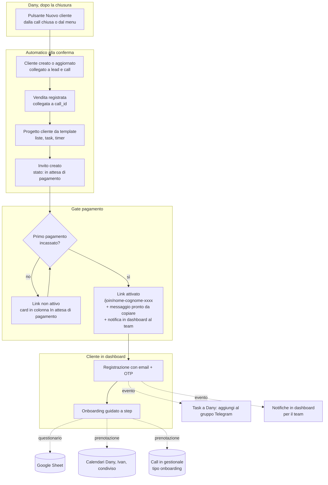
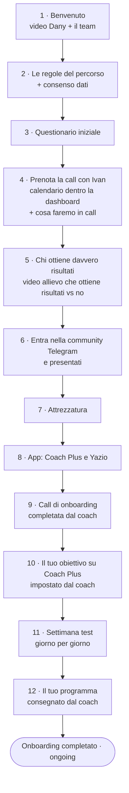

# Onboarding guidato in dashboard · Percorso Alpha

Specifica completa per Claude Code. Versione 7, 12/11/2026. Owner: Dany Monta, founder di Percorso Alpha.

Questo file contiene **tutto quello che voglio**: visione, decisioni già prese, flusso, regole, dati, integrazioni, design e criteri di accettazione. Leggilo tutto prima di proporre il piano.

---

## A. Visione

Percorso Alpha è un percorso di trasformazione fisica per uomini sopra i 25 anni: massa muscolare e definizione allenandosi a casa a corpo libero, con un focus specifico sul petto scavato (pectus). Il messaggio del brand: **"Non è solo fisico. È sicurezza personale."**

Nel percorso diamo supporto, scheda di allenamento e direzione sull'alimentazione. Quello che fa la differenza è quanto il cliente aderisce a queste indicazioni nella sua vita reale, e la mentalità con cui affronta il percorso. La dashboard deve costruire proprio questo: **chiarezza, disciplina, consapevolezza**.

Cosa voglio, in una frase: **chiudo la vendita, il pagamento è confermato, premo un pulsante e tutto il resto parte da solo.** Il cliente viene guidato passo per passo, a prova di errore, dentro la mia dashboard. Il mio team vede in ogni momento chi è a che punto e cosa deve fare.

## B. Decisioni già prese (non rimetterle in discussione)

1. **Il link di onboarding si attiva solo a pagamento confermato.** Prima del pagamento il link esiste ma non funziona.
2. **Niente più Google Form.** Il questionario si compila in dashboard, ma ogni risposta continua ad aggiungere una riga al foglio Google esistente, che è un asset per il marketing.
3. **Niente più pagine Notion duplicate per cliente.** Le sostituisce la dashboard del cliente, con un link condivisibile.
4. **La call di onboarding si prenota dal calendario di Ivan**, mostrato dentro la dashboard. Ogni call prenotata è sincronizzata sui calendari di Ivan, di Dany e sul calendario condiviso del team.
5. **Step bloccanti.** Il cliente passa allo step successivo solo dopo aver completato il precedente. L'onboarding finisce solo quando ha visto tutte le risorse obbligatorie.
6. **Niente Skool.** La formazione (moduli, video, avanzamento) sta in dashboard. La community sta su **Telegram**, in un gruppo unico diviso in Topic (sezioni come in un forum), con group coaching settimanale. Il canale broadcast Telegram verrà chiuso: lo sostituisce il Topic "Annunci" della community.
7. **Presentazione obbligatoria nella community Telegram.** Il cliente la conferma in dashboard e il team controlla a campione.
8. **Niente bot Telegram per ora.** Gli ingressi sono pochi: ingressi nella community, presentazioni e wins si gestiscono con poche azioni manuali del team, e le notifiche al team arrivano in dashboard. Il bot è un'estensione futura opzionale (sezione 12).
9. **Solo tre punti di contatto per il cliente**, ognuno con un compito unico:
   - dashboard: onboarding con la timeline, guide e risorse, moduli, Libreria esercizi, bacheca wins;
   - Coach Plus: scheda, dati, video degli allenamenti, obiettivo SMART e milestone;
   - Telegram: gruppo privato con il coach, più la community di tutti gli allievi.
10. **Ogni nuovo cliente ha un progetto nel gestionale**, con task e timer per tracciare il tempo del team.
11. **Tutto collegato alla vendita:** lead, call, vendita, cliente, progetto, onboarding e call di onboarding sono sempre legati tra loro.
12. **Obiettivi e milestone si pianificano su Coach Plus.** La dashboard non replica i database Notion "La tua scalata verso la vetta" (milestone) e "I tuoi steps" (roadmap). Il cammino del cliente fino all'inizio del percorso si mostra con la **timeline orizzontale animata** (sezione 4.4).
13. **La dashboard Notion attuale è il riferimento** per struttura, guide, testi e tono. Va studiata e migrata nei contenuti (sezioni 7 e 7-bis), non copiata nella forma.
14. **Tempi fissi del percorso:** programma consegnato circa **24-48 ore** dopo l'ultimo test; **checkup con il coach una volta al mese**, il primo circa 5 settimane dopo la call di onboarding. Dove Notion dice altro (2-5 giorni lavorativi, checkup ogni 2 settimane), è superato.

## C. Principi di prodotto

- **A prova di errore.** Una sola cosa da fare per schermata, con le parole giuste. Il cliente non deve mai chiedersi "e adesso?".
- **Automatico per default.** Ogni passaggio che oggi qualcuno fa a mano va automatizzato, o diventa un task con responsabile e scadenza.
- **Il cliente non esce dalla dashboard**, salvo che per Coach Plus, Yazio e Telegram.
- **Il team vede tutto in un colpo d'occhio:** chi è fermo, da quanto, e cosa serve.
- **Fluido.** Transizioni morbide e feedback immediato a ogni azione: deve sembrare un prodotto premium, non un form.

## D. Brand, design e testi

- **Palette:** bordeaux, oro e grigio scuro sono i colori del brand. Se nel repo esiste già un tema, usa quello.
- **Stile:**
  - chiaro e semplice, nello spirito di Notion ma più pulito;
  - tanto spazio bianco, titoli grandi, poco testo per blocco;
  - card solo dove servono;
  - tema chiaro e scuro.
- **Mobile first:** la maggior parte dei clienti apre da telefono, dal link Telegram.
- **Testi rivolti al cliente:**
  - italiano corretto, sempre con gli accenti;
  - tono diretto, autorevole ed empatico, da coach e mentore, non da influencer;
  - frasi brevi;
  - niente emoji;
  - **mai il trattino lungo (em dash)**;
  - niente promesse irrealistiche.
- **Valori da trasmettere:** disciplina, avventura, miglioramento costante.
- **Testi d'errore:** dicono cosa è successo e cosa fare, senza scuse e senza codici tecnici.

---

## Obiettivo operativo

Dopo la chiusura di una vendita, a Dany basta premere **"Nuovo cliente"** nella dashboard (dashboard.percorsoalpha.com). Quando il pagamento è confermato, il sistema:

- attiva il link di registrazione personale;
- guida il cliente dentro la dashboard in un onboarding a step bloccanti, senza mai mandarlo fuori: questionario, prenotazione della call con Ivan, video formativi, attrezzatura, app, settimana test.

Cliente, vendita e progetto con il timer del tempo vengono creati già alla conferma di "Nuovo cliente".

Spariscono il Google Form, le pagine Notion duplicate per cliente e i passaggi manuali tra vendita e coach.

---

## 0. Prima di scrivere codice

1. Esplora il repository: stack, autenticazione, schema DB.
2. Il gestionale ha già queste entità, da riusare e non duplicare:
   - lead;
   - call, con esito e registrazione Fathom;
   - vendita, collegata a `call_id`;
   - cliente, con cartella Drive e contratto;
   - rate;
   - progetti, con liste, task, note e timer del tempo;
   - team.
3. L'invio di codici OTP via email esiste già in Alpha Loom (`auth@percorsoalpha.com`): riusalo per il login dei clienti.
4. Proponi il piano (MVP, v2, v3) e chiedi conferma prima di modificare schema DB e autenticazione.
5. **Animazioni: usa Motion** (pacchetto npm `motion`, motion.dev). Funziona sia con React sia con Angular grazie all'API vanilla (`animate`, `spring`, `stagger`, `inView`). È leggera, accelerata via hardware e adatta a glow, molle e sequenze. Usa GSAP solo se serve qualcosa che Motion non fa bene, per esempio tracciati SVG complessi, e dimmelo prima. Rispetta sempre `prefers-reduced-motion`. Icone: Lucide (razzo, spunta, lucchetto), mai emoji.
6. **Connettori:** in questo file trovi i link originali (Notion, Google Drive, Google Sheets, Google Calendar). Collegati tu ai connettori e leggi pagine e file direttamente alla fonte, comprese immagini e video caricati su Notion. Parti dalle pagine Notion della sezione 7-bis prima di progettare la dashboard cliente. I riassunti nel file sono solo un riferimento rapido: in caso di differenze vale la fonte.
7. Credenziali e identificativi in variabili d'ambiente, mai nel codice:
   - `ADMIN_EMAIL` (Dany);
   - `COACH_EMAIL` (Ivan);
   - `SHARED_CALENDAR_ID`;
   - `BOOKING_SCHEDULE_URL`;
   - `INTAKE_SHEET_ID`;
   - `COMMUNITY_INVITE_URL` (link fisso alla community Telegram, con richiesta di accesso);
   - credenziali SMTP o del servizio email già in uso per gli OTP.

---

## 1. Flusso attuale (da sostituire)

Dalla descrizione di Ivan (4/11/2026), dai template su Drive e dalle chat Telegram. Caso reale: cliente entrato il 29/10, call di onboarding il 7/11. **9 giorni contro le 72 ore dichiarate.** Su 38 passaggi, 18 sono manuali e in mano a Ivan.

```mermaid
flowchart LR
  A[Call di vendita] --> B[Pagamento] --> C[Gruppo Telegram a mano]
  C --> D[Google Form a mano] --> E[Dany cita Ivan su Telegram]
  E --> F[Ivan si presenta e propone data] --> G[Call onboarding]
  G --> H[Notion duplicato a mano + accesso abilitato da Dany]
  H --> I[Settimana test] --> J[Controllo dati manuale ogni giorno]
  J --> K[Prima scheda] --> L[Template alimentare] --> M[Ongoing]
```



---

## 2. Macro flusso automatizzato

Una sola azione manuale di Dany per avviare tutto: **"Nuovo cliente"**.



### 2.1 Il pulsante "Nuovo cliente"

Disponibile in due punti: dalla scheda di una call con esito `chiusa`, con i dati precompilati, oppure dal menu Clienti.

Wizard in 3 schermate:

1. **Cliente**: nome, cognome, email, telefono, username Telegram. Precompilati dal lead e dalla call se esistono.
2. **Vendita**: prodotto e durata (es. Percorso Alpha 6 mesi), modalità di pagamento, data inizio. Usa la logica esistente di registrazione vendita con `call_id`.
3. **Team**: coach assegnato (default Ivan), revisore video (default Lorenzo), Personal Success Manager (default Dany).

Alla conferma, in una transazione unica (se un passaggio fallisce, nulla resta a metà):

- crea o aggiorna il **cliente** e lo collega a lead, call e vendita;
- registra la **vendita**;
- crea il **progetto** "Nome Cognome · Percorso Alpha" dal template "Onboarding cliente", con timer del tempo attivo e liste e task precaricati (sezione 2.2);
- genera l'**invito** con link personale in stato `pending_payment` (sezione 3);
- se il primo pagamento risulta già incassato, attiva subito il link. Altrimenti la schermata finale dice "Il link si attiva appena registri il pagamento" e mostra il pulsante **"Conferma pagamento"**.

### 2.1.1 Gate pagamento

- Il link passa da `pending_payment` ad `active` quando succede una di queste cose:
  - la prima rata della vendita viene segnata come incassata (anche il saldo unico);
  - Dany preme "Conferma pagamento" nella scheda cliente: azione manuale, con log;
  - più avanti, il webhook dello strumento di pagamento (Stripe, Klarna, HeyLight, PayPal) conferma l'incasso.
- All'attivazione:
  - notifica in dashboard al team: "Pagamento confermato per [Nome], link di onboarding attivo";
  - il pulsante "Copia link" diventa disponibile nella scheda vendita e nella scheda cliente.
- Se il cliente apre il link prima del pagamento, vede "Il tuo accesso si attiva appena il pagamento è confermato. Ti avvisiamo noi." Nessun dato del percorso è visibile.
- Se la vendita viene annullata o rimborsata, il link si disattiva e l'eventuale account cliente passa in sola lettura.

Al momento dell'attivazione la dashboard mostra il link, il pulsante "Copia link" e il messaggio pronto:

> Benvenuto nel Percorso Alpha, [Nome]. Da qui parte tutto: registrati con la tua email e segui gli step uno alla volta. [link]

### 2.2 Template del progetto cliente

Il progetto serve al team per tracciare tempo e lavoro su ogni cliente. Task creati in automatico, con responsabile e scadenza relativa al giorno 0, cioè la registrazione del cliente:

| Task | Responsabile | Scadenza | Si chiude da solo quando |
|---|---|---|---|
| Crea il gruppo privato Telegram e aggiungi il cliente | Dany | giorno 0 | Dany spunta il task |
| Approva la richiesta di accesso alla community | Dany o Ivan | giorno 0-1 | spunta del team |
| Leggi il questionario prima della call | Ivan | prima della call | il coach apre la scheda questionario |
| Call di onboarding | Ivan | data prenotata | il coach segna la call come svolta |
| Imposta obiettivo SMART e milestone su Coach Plus | Ivan | entro 24 ore dalla call | spunta del coach |
| Verifica il cliente su Coach Plus e assegna i test | Ivan | entro 24 ore dalla call | spunta del coach |
| Revisione video dei test | Lorenzo | all'arrivo dei test | spunta del revisore |
| Prima scheda 4 settimane consegnata | Ivan | 48 ore dall'ultimo test | il coach segna lo step "Programma" |
| Template alimentare dopo 5 giorni di dati | Ivan | giorno 5 di tracciamento | spunta del coach |
| Primo checkpoint mensile | Ivan | circa 5 settimane dalla call, poi ogni mese | call registrata |

---

## 3. Registrazione e collegamento al cliente

- Link personale: `/join/:slug-:token`, con slug leggibile (nome e cognome) e token casuale di 32 byte salvato come hash. Monouso.
- Stati del link: `pending_payment` → `active` → `used`. Altri stati possibili: `expired` e `revoked`.
- Scadenza: 14 giorni a partire dall'attivazione, cioè dal pagamento confermato, non dalla creazione.
- Il cliente apre il link e trova l'email precompilata, che può correggere. Riceve l'OTP, entra e l'account (ruolo `client`) è già legato al suo `client_id`.
- Se l'email inserita è diversa da quella del lead, l'account si collega comunque tramite il token: l'email del cliente si aggiorna e il cambio va nel log.
- Link scaduto o già usato: pagina chiara con "Chiedi un nuovo link al tuo coach". Il team lo rigenera dalla scheda cliente.
- Con un rinnovo il cliente resta sullo stesso account. L'onboarding non riparte, a meno che il team non lo riavvii.

---

## 4. Onboarding guidato (lato cliente)

### 4.1 Gli step

Uno step si sblocca solo quando il precedente è completato, con verifica lato server. Gli step dal 5 all'8 sono "l'attesa attiva": si sbloccano dopo la prenotazione e vanno completati prima della call.



| # | Step | Contenuto | Completamento | Verifica team |
|---|---|---|---|---|
| 1 | Benvenuto | Video di Dany, max 5 minuti. Card del team con foto e ruoli: Dany (Personal Success Manager), Ivan (coach), Lorenzo (revisione video). | Video visto almeno al 90% | No |
| 2 | Le regole del percorso | Telegram per imprevisti e dubbi, Coach Plus per i dati, call confermate, preavviso di 24-48 ore. Regole della community Telegram. Consenso al trattamento dei dati sanitari e delle foto, e consenso a mostrare le proprie wins nella bacheca interna. | Una checkbox per ogni regola, più i consensi | No |
| 3 | Questionario iniziale | Il Google Form ricostruito in dashboard (sezione 6). | Invio con validazione | No |
| 4 | Prenota la call con Ivan | Calendario di prenotazione dentro la dashboard (sezione 5), con il riquadro "Cosa faremo in call" (sezione 4.2). | Prenotazione rilevata dal calendario | No |
| 5 | Chi ottiene davvero risultati | Video di Dany: allievo che ottiene risultati vs allievo che non li ottiene. Esempio: lo screenshot dell'allievo che avvisa quando sta male, cioè il valore della comunicazione. | Video visto almeno al 90% | No |
| 6 | Entra nella community e presentati | Tre azioni guidate in sequenza: (a) campo "Il tuo username Telegram", salvato sul cliente; (b) pulsante "Entra nella community" con il link fisso (`COMMUNITY_INVITE_URL`): il cliente invia la richiesta di accesso e il team la approva; (c) template di presentazione con pulsante "Copia" (chi sono, da dove parto, il mio obiettivo a 6 mesi, perché adesso) da pubblicare nel Topic "Presentazioni". | Il cliente spunta "Mi sono presentato" | Controllo a campione del team, senza bloccare il cliente |
| 7 | Attrezzatura | Checklist generata dalle risposte del questionario (sbarra, metro da sarto, elastico) con link d'acquisto e video "come montare la sbarra" e "come prendere le misure". Per ogni voce: "Ce l'ho" oppure "Arriva il [data]". | Tutte le voci dichiarate e video visti | No |
| 8 | App | Registrazione a Coach Plus (link del coach) e Yazio (iOS e Android). Video tutorial: dove caricare misure, foto, video e questionario giornaliero. Avviso fisso: "Su Yazio ignora i target dell'app". | Le due checkbox spuntate e il video visto | Sì: il coach conferma di vedere il cliente su Coach Plus |
| 9 | Call di onboarding | Countdown, link Meet, data, cosa preparare. | Il coach segna "svolta" | Sì (azione del coach) |
| 10 | Il tuo obiettivo su Coach Plus | Testo breve: "Il tuo obiettivo SMART e le tue milestone sono su Coach Plus, impostati dal coach dopo la call." Pulsante "Apri Coach Plus". | Il cliente conferma "Ho visto il mio obiettivo" | Si sblocca quando il coach spunta il task "Imposta obiettivo SMART e milestone su Coach Plus" |
| 11 | Settimana test | Ripresa dalla pagina Notion "Settimana di test di valutazione" (sezione 7-bis), compiti in ordine: (1) registrazione su Coach Plus e avviso al coach, già spuntato se fatto allo step 8; (2) 3 foto del fisico in Coach Plus, sezione Progressi; (3) tracciamento con Yazio e kcal e macro nel questionario giornaliero di Coach Plus, per almeno 5 giorni; (4) circonferenze in Coach Plus, con video e link al metro da sarto. Poi, prima dei test: guida alle riprese video e verifica dell'attrezzatura. Messaggio fisso: "Quando hai completato test e tracciamenti, ricevi il programma in circa 24-48 ore." I test arrivano in Coach Plus: una sessione al giorno, ognuna con i video degli esercizi dalla Libreria e l'avviso "carica il video durante l'allenamento". | Ogni voce spuntata dal cliente | Sì: il coach conferma test e tracciamenti ricevuti |
| 12 | Il tuo programma | Video di spiegazione della scheda, PDF del modello alimentare, lista della spesa, data del primo checkpoint. | Il coach segna "consegnato" e il cliente guarda il video | Sì |

**Regola di completamento:** l'onboarding è chiuso solo quando tutti gli step sono `done` e tutti i video obbligatori risultano visti. Il cliente vede sempre cosa gli manca, con la lista delle risorse non ancora viste.

**Se la call arriva prima della fine degli step 5-8:** la call si fa comunque. Il coach vede nella scheda cliente un avviso "Preparazione incompleta: mancano X", e gli step restano aperti dopo la call.

### 4.2 "Cosa faremo in call": riquadro nello step 4 e nello step 9

> **Call di onboarding con Ivan · 30 minuti su Google Meet**
>
> 1. Rileggiamo insieme il tuo questionario e chiariamo i punti aperti.
> 2. Ti diciamo cosa è realistico ottenere in 3 e in 6 mesi.
> 3. Ti mostriamo cosa misuriamo e perché: peso, torace, vita, braccia, foto.
> 4. Definiamo la strategia di allenamento e alimentazione.
> 5. Ti mostriamo a schermo i test fisici su Coach Plus e come filmarli.
> 6. Ti spieghiamo come tracciare l'alimentazione con Yazio.
> 7. Fissiamo il primo checkpoint, tra circa 5 settimane, e poi uno ogni mese.
>
> **Cosa preparare:** questionario compilato, attrezzatura a portata di mano, telefono o computer con cui puoi condividere lo schermo, 30 minuti senza interruzioni.

Testo modificabile dal CMS (sezione 9).

### 4.3 UX richiesta: a prova di errore

- Una sola azione primaria per schermata, con un pulsante esplicito ("Ho guardato il video", "Invia il questionario").
- Niente barra di avanzamento né lista di step: l'orientamento lo dà la **timeline orizzontale** in cima alla pagina (sezione 4.4).
- Sotto la timeline c'è un solo pannello: le azioni del prossimo step, e nient'altro.
- Animazioni con Motion, descritte nella sezione 4.4. Tutto disattivato con riduzione movimento.
- Mobile first: quasi tutti aprono da telefono dal link Telegram.
- Video: YouTube non in elenco con IFrame API per misurare la percentuale vista; Alpha Loom e Loom tramite embed. Lazy load. La percentuale vista si salva sul server.
- Ripresa automatica dallo stesso punto, con le risposte salvate.
- Messaggi d'errore in italiano chiaro, mai codici tecnici.

### 4.4 La timeline orizzontale animata

È il cuore dell'esperienza. Durante tutto l'onboarding sta in cima alla dashboard del cliente e risponde a due domande: **quanto manca all'inizio del mio percorso** e **cosa devo ancora completare**.

```
  Mancano circa 9 giorni all'inizio del tuo percorso · Ti restano 6 cose da fare

  (✓)━━━━━━(✓)━━━━━━(◉)┄┄┄┄┄┄( )┄┄┄┄┄┄( )┄┄┄┄┄┄( )┄┄┄┄┄┄[razzo]
Benvenuto  Questionario  Call      Preparazione  Call di     Settimana   Inizio
                        prenotata              onboarding    test       percorso
```

**Nodi.** Sette nodi raggruppano i 12 step:

| Nodo | Step | Significato |
|---|---|---|
| 1 · Benvenuto | 1-2 | video di benvenuto e regole |
| 2 · Questionario | 3 | questionario iniziale |
| 3 · Call prenotata | 4 | prenotazione con Ivan |
| 4 · Preparazione | 5-8 | video "Chi ottiene davvero risultati", community, attrezzatura, app |
| 5 · Call di onboarding | 9-10 | call svolta, obiettivo visibile su Coach Plus |
| 6 · Settimana test | 11 | foto, misure, tracciamento, test |
| Razzo · Inizio percorso | 12 | programma consegnato: il percorso parte |

**Stati del nodo:**

- **completato:** pieno, spunta, glow tenue;
- **attuale:** anello che pulsa con glow, etichetta in evidenza;
- **futuro:** solo contorno, lucchetto, opacità ridotta;
- **razzo:** in attesa fluttua leggermente; al lancio parte (vedi animazioni).

**Linea:**

- piena con gradiente e glow tra i nodi completati;
- tra l'ultimo nodo completato e il nodo attuale si riempie in proporzione alle azioni fatte (es. 2 su 4 nella Preparazione = 50%);
- tratteggiata verso i nodi futuri.

**Interazione: si vede solo il prossimo step.**

- Toccare il **nodo attuale** apre sotto la timeline il pannello con le azioni del prossimo step da fare. È l'unico contenuto operativo mostrato.
- Toccare un **nodo completato** mostra un riepilogo breve: cosa hai fatto e quando. Nessuna azione.
- Toccare un **nodo futuro** fa una leggera vibrazione del nodo e mostra il tooltip "Si sblocca dopo: [nodo attuale]". Il contenuto non si vede.

**Stima dei giorni all'inizio del percorso.** Calcolo lato server, durate configurabili dall'admin:

| Situazione | Data stimata di inizio |
|---|---|
| call non ancora prenotata | oggi + 3 giorni (call) + 7 giorni (settimana test) + 2 giorni (programma) |
| call prenotata | data della call + 7 + 2 |
| settimana test in corso | data prevista dell'ultimo test + 2 |
| programma consegnato | data reale: il razzo parte |

Regole della stima:

- si mostra sempre "circa";
- mai numeri negativi: se la data stimata è passata, il testo diventa "Ci siamo quasi";
- il contatore "Ti restano N cose da fare" conta le azioni obbligatorie non completate fino al razzo.

**Animazioni (Motion), con i colori della dashboard:**

- **all'apertura:** la linea si disegna da sinistra fino al nodo attuale (700-900 ms, ease-out) e i nodi compaiono in sequenza (stagger 60 ms);
- **nodo attuale:** glow che respira in loop (circa 2,4 s);
- **azione completata:** il segmento della linea avanza con una molla (spring);
- **nodo completato:**
  - il nodo fa un piccolo "pop" (scala 1 → 1,15 → 1, spring) e la spunta si disegna;
  - un lampo di glow, poi la linea corre fino al nodo successivo, che si sblocca con l'animazione del lucchetto che si apre;
  - il pannello passa al contenuto nuovo con dissolvenza e scorrimento;
- **contatore dei giorni:** quando la stima cambia, il numero scorre fino al nuovo valore;
- **lancio del razzo**, a programma consegnato:
  - il razzo sale con una scia luminosa e poche particelle leggere;
  - compare il messaggio "Il tuo percorso è iniziato";
  - la dashboard passa alla versione ongoing.

**Vincoli tecnici:**

- **colori:** solo token CSS del tema della dashboard (palette bordeaux, oro, grigio scuro). Il glow usa il colore di accento con `filter: drop-shadow` o `box-shadow`; niente colori scritti nel codice. Funziona in tema chiaro e scuro;
- **prestazioni:** si anima solo `transform`, `opacity` e `filter`. Obiettivo 60 fps su un telefono di fascia media; i loop si mettono in pausa quando la timeline non è visibile;
- **telefono:**
  - la timeline scorre in orizzontale con scroll-snap e centra in automatico il nodo attuale;
  - etichette brevi sotto i nodi;
  - il pannello delle azioni occupa tutta la larghezza;
- **computer:** la timeline sta tutta nella larghezza;
- **accessibilità:**
  - ogni nodo è un pulsante con etichetta (es. "Questionario, completato");
  - navigazione con le frecce della tastiera;
  - nodi futuri con `aria-disabled`;
- **riduzione movimento:** stati statici, niente loop, transizioni istantanee.

Dopo il lancio la timeline lascia il posto alla dashboard ongoing (sezione 7), con in alto la fase attuale e il prossimo checkpoint.

---

## 5. Prenotazione della call: embed e sincronizzazione calendari

Pagina di prenotazione esistente (Google Calendar appointment schedule): `https://calendar.app.google/NfrFetR52H9b6rbWA`

### 5.1 Embed in dashboard

- Il link breve fa redirect alla pagina completa `https://calendar.google.com/calendar/appointments/schedules/<ID>`. Risolvi l'URL finale una volta e salvalo in `BOOKING_SCHEDULE_URL`.
- Mostra la pagina dentro lo step 4 con un iframe: `<BOOKING_SCHEDULE_URL>?gv=true`, il formato di embed inline previsto da Google. Altezza responsive, bordo nascosto, caricamento con skeleton.
- Precompila nome ed email del cliente, se Google lo consente via parametri. Se non è possibile, mostra sopra l'iframe "Usa questa email: [email]", perché il collegamento automatico (5.2) si basa sull'email.
- Fallback se l'iframe non carica o è bloccato: pulsante "Apri il calendario" in una nuova scheda, con ritorno automatico allo step quando la prenotazione viene rilevata.
- Dall'iframe la dashboard non può leggere niente (cross-origin): la prenotazione si rileva solo lato server.

### 5.2 Rilevare la prenotazione e collegarla al cliente

- OAuth sul calendario proprietario della pagina di prenotazione (presumibilmente quello di Ivan), con scope di lettura e scrittura eventi.
- Ascolto con `events.watch` (notifiche push sul webhook) più sincronizzazione incrementale con `syncToken`. Polling ogni 2 minuti come rete di sicurezza.
- Per ogni nuovo evento creato dalla pagina di prenotazione:
  1. cerca tra gli invitati un'email che corrisponda a un `ClientUser`. In alternativa, un cliente fermo allo step 4 che ha aperto lo step negli ultimi 30 minuti, solo come proposta da confermare nella coda del team;
  2. se trovato: step 4 `done`, salva `eventId`, data e link Meet sull'onboarding, crea la **call** nel gestionale (tipo "onboarding", coach Ivan, cliente collegato) e chiude il task "Call di onboarding" quando la call viene segnata svolta;
  3. se non trovato: l'evento va nella coda "Prenotazioni da collegare" per il team.
- Per capire quali eventi arrivano dalla pagina di prenotazione, ispeziona eventi reali e scegli un marcatore affidabile (organizzatore, descrizione, campi della prenotazione). Documenta la scelta.

### 5.3 Sincronizzazione tra Dany, Ivan e calendario condiviso

Ogni call prenotata da questo link deve comparire:

- sul calendario di Ivan (proprietario: già presente);
- sul calendario di Dany: aggiungilo come invitato con `events.patch` e `sendUpdates=all`;
- sul **calendario condiviso** del team (`SHARED_CALENDAR_ID`): crea una copia con `extendedProperties.private.sourceEventId`.

Regole di sincronizzazione:

- spostamento o cancellazione dell'evento originale → aggiorna o elimina la copia sul condiviso e aggiorna la call nel gestionale, con un evento di log;
- prenotazione cancellata dal cliente → lo step 4 torna `available`, il cliente vede "La tua call è stata annullata, prenota un nuovo orario" e il team riceve una notifica in dashboard.

Nota: la verifica della disponibilità su più calendari (Ivan e Dany insieme) dentro la pagina di prenotazione Google richiede un piano a pagamento. Se serve che la call sia libera per entrambi, verifica il piano o valuta più avanti una prenotazione nativa (freebusy su entrambi i calendari e `events.insert`).

---

## 6. Questionario iniziale (sostituisce il Google Form)

Ogni invio:

1. salva le risposte sulla scheda cliente (`IntakeQuestionnaire`);
2. aggiunge una riga al foglio esistente, che è un asset marketing.

Spreadsheet `INTAKE_SHEET_ID = 1gS0fl9dWmqEUKFlfhIt56hayJtpU5DPR1YrWuU47_DQ`, scheda `Risposte del modulo` (gid `412142154`). Va condiviso come editor con il service account.

| Col | Intestazione nel foglio | Campo | Input |
|---|---|---|---|
| A | Informazioni cronologiche | `submittedAt` | automatico, `dd/MM/yyyy HH.mm.ss` Europe/Rome |
| B | Indirizzo email | `email` | dall'account |
| C | Numero di telefono (Telegram) | `phone` | tel con prefisso |
| D | Nome e Cognome | `fullName` | testo |
| E | Altezza / Peso (a digiuno) | `heightCm`, `weightKg` | numeri; nel foglio `"{h} cm / {w} kg"` |
| F | Data di nascita | `birthDate` | data |
| G | Il tuo obiettivo N°1 | `mainGoal` | textarea |
| H | Occupazione | `occupation` | testo |
| I | Da quanto tempo ti alleni (e in quali sport) | `trainingHistory` | textarea |
| J | Quanti giorni a settimana puoi dedicare all'allenamento? | `daysPerWeek` | select più note |
| K | Infortuni / problematiche fisiche | `injuries` | textarea |
| L | Cosa ti ha spinto a farti seguire da me? | `whyMe` | textarea |
| M | Cosa ti piacerebbe ottenere nei prossimi 3-6 mesi? | `goals3to6m` | textarea |
| N | Di quale attrezzatura disponi? | `equipment` | multiselect più testo e foto; **alimenta lo step 7** |
| O | Massimo ripetizioni: piegamenti, trazioni, dip | `maxPushups`, `maxPullups`, `maxDips` | tre numeri o "non lo so"; nel foglio una stringa |
| P | Esercizi con maggiore e minore difficoltà | `hardestEasiest` | textarea più upload vecchia scheda |
| Q | Ti senti pronto e motivato? | `ready` | sì/no |
| R | Quante ore dormi al giorno circa? | `sleepHours` | numero |
| S | Quanto reputi importante la tecnica? | `techniqueImportance` | scala 1-5 |
| T | Sei seguito sul piano alimentare? | `nutritionFollowed` | sì/no più upload |
| U | Organizzi la tua giornata? | `dailyRoutine` | textarea |
| V | Livello attuale di attività fisica | `activityLevel` | select (passi, ore) |
| W | Hai idea di come si mangia bene? | `nutritionKnowledge` | select |
| X | Cattive abitudini | `badHabits` | multiselect più testo |
| Y | Cosa vorrebbe dire per te avere successo? | `successMeaning` | textarea |
| Z | Tempo per ogni giorno di allenamento | `minutesPerSession` | select |
| AA | Vuoi aggiungere qualcosa di rilevante? | `notes` | textarea |
| AB | Data Inizio Percorso | `startDate` | dalla vendita |
| AC | Cliente Attivo/Non attivo | | "Attivo" |
| AD-AG | Pagamento, Numero del rinnovo, Somma €, Note | | **vuoto**, gestito dal team |

Note tecniche:

- **Interfaccia:** 4 schermate (Chi sei, Allenamento, Stile di vita, Obiettivi), con salvataggio automatico.
- **Scrittura sul foglio:** `values.append` con `USER_ENTERED` e `INSERT_ROWS`, una sola volta per questionario (flag `sheetSyncedAt`).
- **Errori:** coda con nuovi tentativi se il foglio non risponde. L'invio del cliente non fallisce mai per colpa del foglio.
- **File caricati:** nella cartella Drive del cliente se l'integrazione esiste, altrimenti nello storage della dashboard.

---

## 7. La dashboard del cliente (sostituisce Notion)

Riferimento da studiare: la dashboard Notion di un cliente attuale, "Dashboard | <cliente di esempio>" (link nella sezione 7-bis). La nuova dashboard ne riprende struttura, guide e tono, ma è più chiara e più semplice:

- un titolo grande per blocco e poco testo;
- tutto leggibile da telefono senza zoom;
- nessun database da aprire.

**Cosa NON si riprende da Notion:**

- il database "La tua scalata verso la vetta" (milestone): obiettivi e milestone ora stanno su Coach Plus;
- il database "I tuoi steps" (roadmap): lo sostituisce la timeline (sezione 4.4);
- la copertina e le icone di Notion: si usano il tema e le icone della dashboard.

**Blocchi della dashboard cliente, in ordine:**

| Blocco | Contenuto | Da dove arriva in Notion |
|---|---|---|
| Benvenuto | "Benvenuto a bordo, [Nome]. Questo sarà il tuo campo base durante tutto il percorso: un luogo che ti aiuta ad avere sempre tutto in ordine e chiari i prossimi passi." Firmato Dany. | Callout "Benvenuto a bordo" |
| Timeline | Durante l'onboarding: la timeline orizzontale con il pannello del prossimo step. Dopo: fase attuale e prossimo checkpoint. | Sostituisce "La tua roadmap" |
| Il tuo toolkit | Tre card: Telegram (contatto diretto con il team: il coach per allenamento e alimentazione, Dany Personal Success Manager), Dashboard (la mappa del percorso: guide, risorse, cosa viene dopo), Coach Plus (la guida operativa: allenamenti, alimentazione, storico, foto, peso, obiettivo e milestone). | Sezione "Il tuo toolkit" della pagina Start |
| I tuoi compiti ricorrenti | Questionario giornaliero su Coach Plus (**non negoziabile**), tracciamento alimentare, peso una volta a settimana, foto del fisico ogni 4 settimane. Ogni voce ha il link alla sua guida. | Callout "I tuoi compiti ricorrenti" |
| Assistenza chat e call | Supporto in chat Telegram, orari, risposta fuori orario solo per urgenze. Checkup con il coach **una volta al mese**, con data e link sempre visibili. Testo dal CMS. Nota: la pagina Notion dice "ogni 2 settimane", è superato. | Callout "Assistenza chat & call" |
| Le tue risorse | Le guide (sezione 7-bis), ognuna come pagina interna con video incorporati. | Colonna "Le tue risorse" |
| Il tuo coach | Foto, nome, ruolo, breve "Chi sono". | "Coach di riferimento" |
| Il tuo obiettivo | Card con pulsante "Apri Coach Plus". Nessun dato duplicato. | (milestone non replicate) |
| Link rapidi | Coach Plus, Yazio, community Telegram, gruppo privato, prossima call, prossimo group coaching. | Nuovo |
| Bacheca wins | Le wins migliori degli allievi. | Nuovo |

- **Regole generali del percorso** (dalla pagina Start) stanno nello step 2 e restano consultabili in "Le tue risorse":
  - segui gli allenamenti su Coach Plus e avvisa in chat se ne salti uno;
  - tracciamento alimentare e foto secondo le guide;
  - comunica in chat tutto quello che può influenzare il percorso;
  - notifiche Telegram attive.
- **Link condivisibile:** `/c/:shareToken` in sola lettura, revocabile, `noindex`. È il link da mandare al posto di Notion. Peso, misure e foto sono visibili solo dopo il login.

---

## 7-bis. Riferimento Notion: pagine da studiare e guide da migrare

Apri ogni link con il connettore Notion e leggi la pagina completa. Ogni guida diventa una pagina interna della dashboard, gestita dal CMS (`ContentBlock`), con i video incorporati. I testi vanno ripresi e resi più asciutti, senza emoji e senza em dash. Immagini e video caricati su Notion (esempi di foto e riprese, tutorial del questionario) si scaricano dal connettore e si caricano nello storage della dashboard.

| Pagina Notion | Link | Contenuto da migrare |
|---|---|---|
| Dashboard di esempio | https://app.notion.com/p/Dashboard-esempio-c1b72934b97082ab8a5a815917b4fa58 | Struttura generale (sezione 7) |
| Start · Parti da qui | https://app.notion.com/p/Start-Parti-da-qui-2bf72934b9708225ab6a0153bf4c2c1a | Video tour della dashboard (https://youtu.be/4WQXH10a19Y, da rifare sulla nuova dashboard), cosa fare adesso, regole generali, il tuo toolkit, "a breve il coach ti contatta". Diventa il contenuto degli step 1-2 e del blocco Toolkit. Il passaggio sull'obiettivo SMART si sposta su Coach Plus. |
| Settimana di test di valutazione | https://app.notion.com/p/Settimana-di-test-di-valutazione-23472934b970832aaddc81cc8cae0b38 | Compiti in ordine (registrazione Coach Plus, 3 foto, tracciamento Yazio, circonferenze), guida riprese e attrezzatura prima dei test, test consegnati in Coach Plus. Diventa lo step 11. |
| Attrezzatura da comprare | https://app.notion.com/p/7f872934b9708356bb148185449d905c | Sbarra intrastipite (Decathlon) se lo stipite è solido, anelli (Amazon), video montaggio sbarra (https://www.youtube.com/watch?v=cR_VCtDkcM4). Nella dashboard la lista si genera dalle risposte del questionario (step 7). |
| Come tracciare quello che mangi | https://app.notion.com/p/3fb72934b97082c3959d8122e8057757 | Yazio gratuito (Android e iOS), almeno 5 giorni consecutivi, kcal e macro nel questionario giornaliero di Coach Plus ogni sera, video tutorial Yazio (https://youtu.be/MQyQ3gvHdqo) e questionario Coach Plus (video caricato su Notion: chiedere il file), avvisi: niente abbonamento necessario, ignora le calorie suggerite dall'app. Due modi: con bilancia, o con foto del pasto nella funzione AI di Yazio. Video stima kcal fuori casa (https://www.youtube.com/watch?v=ilbE1FzZXLw). |
| Come utilizzare Coach Plus | https://app.notion.com/p/00b72934b97082db8027810acbf04184 | Link di registrazione del coach, app Android e iOS, video (https://youtube.com/shorts/WPmJr02_jLQ), attiva le notifiche per i commenti del coach. |
| Come registrare gli allenamenti | https://app.notion.com/p/9df72934b9708372b0d0011607c7e1d5 | Angolazioni (laterale: push up, plank, superman; da dietro: australian pull up, trazioni; 45° frontale: tutti gli altri), esempi corretti, caricamento "Carica allegato" sull'ultima serie, video (https://www.youtube.com/shorts/cbA7Hu0pJbw), consigli: cavalletto e caricamento durante il recupero. |
| Come fare le foto al tuo fisico | https://app.notion.com/p/fb872934b97083148c0c81320154245c | Ogni 4 settimane, 3 foto in intimo (fronte, lato, schiena), al mattino prima di colazione, stesse condizioni, luce naturale, corpo intero e rilassato, errori da evitare con esempi. |
| Come eseguire gli allenamenti | https://app.notion.com/p/cb872934b9708364b0dd81b696a579a5 | Una regola: scendi lento, sali con intenzione, niente rimbalzi; filma l'ultima serie; comunicazione solo testo, niente vocali; se salti un allenamento avvisa subito ("un giorno saltato non è un problema, una settimana in silenzio sì"); alimentazione su Coach Plus, Nutrizione, Piani alimentari. |
| FAQ Alimentazione | https://app.notion.com/p/89a72934b970825fb490017393e5403a | Da migrare integralmente come pagina con domande espandibili. |
| Coach di riferimento: Chi sono | https://app.notion.com/p/2ac72934b97080ae8cdfef13e05a6d6c | Presentazione di Ivan per il blocco "Il tuo coach". |
| Il tuo obiettivo SMART | https://app.notion.com/p/85072934b970820e8a4d81e7e03d02ed | Non si migra come step: l'obiettivo si imposta su Coach Plus. Si può tenere come guida di lettura in "Le tue risorse". |

---

## 8. Vista team

Nuova sezione **Onboarding** nella dashboard admin.

- **Board** con colonne: "In attesa di pagamento", "Link attivo, non registrato", step 1-12, "Bloccato", "Completato". Ogni card mostra:
  - giorni dalla registrazione;
  - ore di fermo sullo step;
  - badge di scadenza;
  - responsabile.
- **Scadenze e allarmi** configurabili:

  | Regola | Azione |
  |---|---|
  | Registrazione → call prenotata: oltre 72 ore | allarme |
  | Ultimo test → programma: oltre 48 ore | allarme |
  | Settimana test, giorno 2 senza dati | email automatica al cliente |
  | Settimana test, giorno 4 senza dati | task al coach |
  | Fermo da più di 5 giorni sullo stesso step | stato "bloccato" |

- **Code di lavoro:** step da verificare (app, test), richieste di accesso alla community da approvare, presentazioni da controllare a campione, prenotazioni da collegare, preparazione incompleta prima della call.
- **Scheda cliente:**
  - timeline dell'onboarding;
  - questionario;
  - video visti con percentuale;
  - log;
  - azioni: "Copia link di registrazione", "Copia link condivisibile", "Sblocca step" (con motivo), "Riavvia onboarding".
- **Metriche:**
  - tempo medio registrazione → call;
  - percentuale di test completati entro 7 giorni;
  - tempo medio alla prima scheda;
  - clienti bloccati;
  - tempo del team per cliente, dal timer del progetto.
- **Notifiche in dashboard** (icona campanella con contatore, più riepilogo email giornaliero facoltativo), brevi e con link alla scheda:
  - registrazione;
  - questionario inviato;
  - call prenotata, spostata o annullata;
  - cliente bloccato;
  - onboarding completato.
- **Ruoli:**
  - admin (Dany): tutto;
  - coach (Ivan): clienti, approvazioni, task su Coach Plus;
  - revisore (Lorenzo): solo gli step con video e test.
  - Nessun dato economico ai ruoli coach e revisore.

---

## 9. Contenuti (CMS minimo)

Tabella `ContentBlock` per gestire testi e video senza deploy:

- campi: titolo, tipo (video, testo, pdf, link), URL, testo in markdown, ordine, step o modulo collegato, obbligatorio sì/no;
- editor semplice nella sezione admin, con anteprima.

Contenuti iniziali da caricare:

- video di benvenuto;
- video "Chi ottiene davvero risultati";
- video "Come montare la sbarra";
- video "Come prendere le circonferenze" (esiste già, pubblicato sul canale il 12/10);
- tutorial Coach Plus e Yazio;
- PDF del modello alimentare e lista della spesa (esistenti);
- FAQ alimentazione (oggi su Notion);
- testo "Cosa faremo in call";
- regole della community Telegram e template di presentazione;
- regole del percorso.

---

## 9-bis. Moduli formativi, Libreria esercizi e community

Dopo l'onboarding la dashboard del cliente diventa il posto dove continua a formarsi. Stessa logica degli step: contenuti in ordine, avanzamento tracciato, sblocco progressivo per fase.

### Moduli per fase del percorso

| Fase | Quando si sblocca | Moduli |
|---|---|---|
| 0 · Parti da qui | Durante l'onboarding | Benvenuto · Il 90% del risultato è la mentalità · Chi ottiene davvero risultati · Regole del percorso · Presentati nella community · Come usare la Libreria esercizi |
| 1 · Settimana test | Dopo la call di onboarding | Setup Coach Plus · Come fare i 3 test · Circonferenze e postura del torace neutra e rilassata · Foto del fisico · Yazio: solo kcal e macro · Il tuo obiettivo SMART · Attrezzatura minima · Come filmarti |
| 2 · Mese 1 | Programma consegnato | Come leggere il programma · Modello alimentare e lista della spesa · FAQ alimentazione · Quando non arrivi ai macro · Le abitudini fuori da allenamento e alimentazione · Il confronto sui social: il nemico peggiore · Il ciclo dei check |
| 3 · Mesi 2-3 | Dopo il primo checkpoint | Leggere i dati senza ansia · Mangiare fuori e in viaggio · Allenarsi in viaggio o senza attrezzatura · Protocollo imprevisti · Perfezionismo e senso di colpa · L'allenamento come ancora mentale · Plateau e motivazione |
| 4 · Autonomia | Dal terzo mese | Tracciamento a occhio · Quando smetti di caricare i video · Mantenere i risultati con una vita sociale normale · Nuovo obiettivo e rinnovo · Racconta la tua trasformazione |
| Group coaching | Dopo ogni sessione | Le registrazioni delle call di gruppo settimanali, una per tema |
| Pectus | Sempre, per chi ha il petto scavato | Cos'è e cosa può fare l'allenamento · Esercizi posturali e per il petto · Misurazione del torace · Video YouTube incorporati |

Ogni modulo è un `ContentBlock` con video incorporato, testo breve e il pulsante "Completato". Il team vede la percentuale di moduli completati per cliente.

### Libreria esercizi

Database di schede, una per esercizio, popolato nel tempo. È collegato ai test dello step 11 e, più avanti, ai programmi.

- **Campi:** nome, categoria (spinta orizzontale, spinta verticale, tirata, gambe, core, pectus e postura, mobilità), muscoli target, attrezzatura, livello, pectus sì/no, video, stato (da registrare, pronta).
- **Struttura della scheda:**
  1. obiettivo;
  2. cosa devi sentire;
  3. cosa NON devi sentire;
  4. setup (mani, piedi, altezza della sbarra);
  5. esecuzione;
  6. errori comuni;
  7. regressione e progressione;
  8. come filmarlo;
  9. video.
- **Filtri:** categoria, attrezzatura, livello.
- **Ricerca** per nome.
- **Prime schede:**
  - push up e larghezza delle mani;
  - V push up;
  - push up con rialzo;
  - australian chin up e row;
  - chin up;
  - dip;
  - face pull;
  - affondi stretti;
  - jumping squat;
  - esercizi posturali per il petto;
  - riscaldamento e gestione dei fastidi ai gomiti.

### Community Telegram

**Struttura.** Un supergruppo "Percorso Alpha · Community" con i Topic attivi, creato e gestito a mano dal team. Nessuna integrazione tecnica con la dashboard.

| Topic | Chi scrive | A cosa serve |
|---|---|---|
| Annunci | solo il team (Topic chiuso) | novità, video formativi, avvisi. Sostituisce il canale broadcast |
| Presentazioni | tutti | ogni nuovo ingresso si presenta qui (step 6) |
| Wins | tutti | progressi, foto, traguardi |
| Domande | tutti | dubbi generali utili a tutti. Quelli personali restano nel gruppo privato |
| Group coaching | team per link e registrazioni, tutti per le domande | call di gruppo settimanali |

**Ingresso nella community (senza bot):**

1. La community ha un link d'invito fisso con "richiesta di accesso" attiva. Il link è salvato in `COMMUNITY_INVITE_URL` e mostrato nello step 6.
2. Il cliente apre il link e invia la richiesta. Un admin la approva da Telegram con un tocco, controllando il nome sulla coda "Richieste di accesso" della dashboard (nome e username Telegram dallo step 6).
3. Il cliente si presenta nel Topic "Presentazioni" e spunta "Mi sono presentato" in dashboard. Il team controlla a campione dalla coda "Presentazioni da controllare" e, se manca, lo segnala al cliente nel gruppo privato.
4. **Gruppo privato:** Dany crea il gruppo come oggi e spunta il task nel progetto del cliente. Il link al gruppo privato può essere salvato sulla scheda cliente e compare nei link rapidi della sua dashboard.

**Wins:**

- gli allievi pubblicano le wins nel Topic "Wins";
- il team sceglie le migliori e le carica in dashboard con il pulsante "Aggiungi win" sulla scheda cliente: testo, foto, data;
- le wins caricate compaiono nella bacheca della dashboard;
- nello step 2 il cliente dà il consenso alla pubblicazione delle proprie wins in bacheca;
- per l'uso nel marketing serve un consenso specifico, separato dal primo.

**Group coaching settimanale:**

- **formato:** un'ora a settimana con un tema preciso, in video chat Telegram nel Topic "Group coaching" o su Meet;
- **sessione in dashboard:** data, tema, link, registrazione. La prossima sessione compare nei link rapidi di ogni cliente;
- **promemoria:** messaggi programmati con la funzione nativa di Telegram, 24 ore e 1 ora prima;
- **dopo la call:** il team carica la registrazione e la sessione diventa un modulo nella sezione "Group coaching" della dashboard, con tracciamento della visione come gli altri moduli.

**Moderazione:**

- regole della community nel messaggio fissato e nello step 2;
- il team modera;
- il Topic "Annunci" è chiuso ai messaggi degli allievi (impostazione nativa dei Topic).

**Limite noto:** Telegram non ha classifiche né gamification, e le wins scorrono via nella chat. Si compensa in dashboard:

- la bacheca wins resta fissa;
- in v3 una classifica della costanza (giorni di tracciamento consecutivi, allenamenti con video), visibile solo agli allievi.

---

## 10. Modello dati (indicativo, da adattare allo schema esistente)

```ts
OnboardingInvite   { id, slug, tokenHash, clientId, saleId, callId, leadId, email,
                     status: 'pending_payment'|'active'|'used'|'expired'|'revoked',
                     activatedAt, activatedBy: 'payment'|'manual'|'webhook', expiresAt, usedAt, createdBy, createdAt }
ClientUser         { id, email, clientId, role: 'client', lastLoginAt }
OnboardingFlow     { id, version, steps: StepDef[] }
StepDef            { key, order, title, type: 'video'|'rules'|'form'|'booking'|'external_link'|'checklist'|'team_action'|'read_confirm',
                     requiresReview, contentBlockIds, estimatedMinutes, unlockAfter: stepKey }
OnboardingProgress { id, clientId, flowVersion, currentStepKey, status: 'onboarding'|'blocked'|'ongoing',
                     steps: Record<stepKey, { status: 'locked'|'available'|'in_progress'|'submitted'|'done',
                     startedAt, submittedAt, completedAt, data, reviewedBy, reviewNote }> }
VideoView          { id, clientId, contentBlockId, maxPercent, lastPositionSec, completedAt }
IntakeQuestionnaire{ id, clientId, answers, submittedAt, sheetRow, sheetSyncedAt }
OnboardingBooking  { id, clientId, sourceEventId, sharedEventId, startAt, meetUrl, status: 'booked'|'moved'|'cancelled'|'done', callId }
TimelineNode       { key, order, title, stepKeys: string[], icon }        // i 7 nodi della timeline
StartEstimate      { clientId, estimatedStartAt, basis: 'no_call'|'call_booked'|'test_week'|'started', remainingActions, computedAt }
ShareLink          { id, clientId, tokenHash, createdAt, revokedAt }
ContentBlock       { id, kind, title, url, body, order, required, scope: { stepKey?, moduleKey? } }
OnboardingEvent    { id, clientId, actor, type, from, to, payload, createdAt }   // log immutabile
ProjectTemplate    { id, name, lists: [{ name, tasks: [{ title, assigneeRole, dueRule }] }] }
TelegramInfo       { clientId, username, communityJoinApprovedAt, presentedAt, presentationCheckedBy, privateGroupUrl }   // campi sulla scheda cliente
Win                { id, clientId, text, mediaUrls, happenedAt, addedBy, visible, consentInternal, consentExternal }
Notification       { id, recipientUserId, type, clientId, text, link, readAt, createdAt }
CoachingSession    { id, title, topic, startAt, joinUrl, recordingContentBlockId, attendees: clientId[] }
```

---

## 11. Integrazioni

| Servizio | Uso |
|---|---|
| Gestionale esistente | clienti, vendite, call, progetti, timer: sorgente unica di verità |
| Email OTP `auth@percorsoalpha.com` | login clienti (riuso da Alpha Loom) |
| Google Calendar API | rilevare le prenotazioni, aggiungere Dany, copiare sul condiviso, seguire spostamenti e cancellazioni |
| Google Sheets API | riga del questionario |
| Email (servizio già usato per gli OTP) | reminder ai clienti (es. giorno 2 senza dati), riepilogo giornaliero facoltativo per il team |
| Telegram | nessuna integrazione tecnica per ora: link fissi (community, gruppo privato) salvati in dashboard |
| YouTube IFrame API | percentuale video vista |
| Coach Plus | nessuna integrazione: conferme manuali del coach |

---

## 12. Piano di rilascio

**MVP**
- "Nuovo cliente" con progetto da template e link di registrazione;
- timeline orizzontale con stati, stima dei giorni e pannello del prossimo step (animazioni base);
- gate pagamento: rata incassata o conferma manuale;
- login con OTP;
- step 1-4 e 9-12 con blocco lato server;
- questionario con riga sul foglio;
- embed della prenotazione;
- rilevamento delle prenotazioni e sincronizzazione dei tre calendari;
- board del team;
- notifiche in dashboard per il team;
- step 6 con link alla community e conferma del cliente.

**v2**
- step 5-8 con tracciamento dei video;
- bacheca wins con caricamento da parte del team;
- group coaching: sessioni, promemoria, registrazioni come moduli;
- dashboard cliente (sezione 7) con le guide migrate da Notion (sezione 7-bis);
- animazioni complete della timeline, compreso il lancio del razzo;
- CMS;
- scadenze e allarmi;
- metriche;
- link condivisibile.

**v3**
- reminder automatici al cliente;
- seconda call di revisione dei test come step opzionale;
- moduli formativi e Libreria esercizi;
- classifica della costanza;
- migrazione completa dei contenuti Notion;
- chiusura del canale broadcast Telegram.

**Futuro (opzionale, quando gli ingressi aumentano): bot Telegram.**

Da valutare solo se le azioni manuali diventano un peso. Possibili funzioni, in ordine di utilità:

1. notifiche al gruppo del team sui movimenti dell'onboarding (registrazioni, questionari, call prenotate, clienti bloccati);
2. collegamento dell'account Telegram tramite deep link e inviti personali monouso alla community e al gruppo privato;
3. rilevamento automatico della presentazione nel Topic e chiusura dello step 6;
4. raccolta automatica delle wins dal Topic in una coda da approvare.

Lo schema dati e le notifiche vanno progettati da subito in modo che il bot si possa aggiungere dopo senza rifare nulla (es. `Notification` con un campo canale).

---

## 13. Criteri di accettazione

- [ ] Da una call chiusa, "Nuovo cliente" crea in un solo passaggio cliente, vendita, progetto con task e timer, e il link di registrazione in stato "in attesa di pagamento".
- [ ] Il link non funziona finché il primo pagamento non risulta incassato, o finché Dany non preme "Conferma pagamento". All'attivazione il team riceve la notifica in dashboard.
- [ ] Una vendita annullata o rimborsata disattiva il link.
- [ ] Il cliente si registra da telefono in meno di un minuto ed è collegato al `client_id` corretto.
- [ ] Nessuno step bloccato è accessibile, né dall'interfaccia né via API.
- [ ] L'invio del questionario aggiunge la riga corretta (A-AC) sul foglio e salva le risposte sulla scheda cliente.
- [ ] Il calendario di prenotazione si apre dentro la dashboard. Entro 2 minuti dalla prenotazione lo step 4 risulta completato e la call compare sui calendari di Ivan, Dany e del team e nel gestionale.
- [ ] Spostare o annullare la prenotazione aggiorna i tre calendari, la call nel gestionale e lo step del cliente.
- [ ] L'onboarding risulta completato solo quando tutti gli step e i video obbligatori sono completati.
- [ ] La timeline mostra i giorni stimati all'inizio del percorso e le cose ancora da fare. Toccando il nodo attuale si apre solo il prossimo step; i nodi futuri non mostrano contenuti.
- [ ] Completare un'azione fa avanzare la linea e, a nodo completato, sblocca il successivo con l'animazione prevista, fluida su un telefono di fascia media.
- [ ] Alla consegna del programma parte il razzo e la dashboard passa alla versione ongoing.
- [ ] Tutte le guide della sezione 7-bis sono pagine interne con video incorporati.
- [ ] Nello step 6 il cliente salva il suo username Telegram, apre il link della community e spunta "Mi sono presentato". Il team lo vede nella coda delle presentazioni da controllare.
- [ ] Una win caricata dal team compare nella bacheca della dashboard dei clienti.
- [ ] Le notifiche al team compaiono in dashboard con il contatore e il link alla scheda cliente.
- [ ] Animazioni fluide su un telefono di fascia media, disattivate con riduzione movimento.
- [ ] Nessun dato economico visibile a coach e revisore.

---

## 13-bis. Come voglio che lavori (istruzioni per Claude Code)

1. **Prima leggi, poi proponi.** Esplora il repository e scrivi un piano diviso in MVP, v2 e v3, con i file che toccherai e le migrazioni del DB. Aspetta il mio sì prima di modificare schema e autenticazione.
2. **Riusa quello che c'è.** Clienti, vendite, rate, call, progetti, timer, team e OTP esistono già. Estendili, non duplicarli.
3. **Lavora a piccoli passi verificabili.** Una funzionalità per volta, con test automatici sulla logica critica:
   - blocco degli step lato server;
   - gate pagamento;
   - collegamento delle prenotazioni;
   - append sul foglio;
   - stati del link;
   - notifiche al team.
4. **Prima i dati e le regole, poi l'interfaccia.** Le animazioni arrivano quando il flusso funziona.
5. **Ogni integrazione esterna deve reggere i guasti:** coda, nuovi tentativi, log. Un errore di Google o Telegram non deve mai bloccare il cliente.
6. **Niente segreti nel codice.** Tutto in variabili d'ambiente, con un `.env.example` aggiornato.
7. **Testi in italiano con gli accenti, senza em dash e senza emoji.** Se un testo rivolto al cliente non ti è chiaro, mettilo nel CMS con un segnaposto evidente e dimmelo.
8. **Alla fine di ogni fase** dammi:
   - cosa è fatto;
   - come provarlo (passi concreti, account di test);
   - cosa manca e le decisioni che servono da me.
9. **Se qualcosa in questo file non è fattibile** (es. un limite di Google Calendar), dimmelo subito con l'alternativa migliore, invece di aggirarlo in silenzio.

---

## 14. Domande aperte per Dany

1. La pagina di prenotazione è sul calendario di Ivan o sul tuo? Serve l'autorizzazione OAuth del proprietario.
2. Calendario condiviso: ne esiste già uno del team, o va creato ("Percorso Alpha · Call clienti")?
3. Alla call di onboarding partecipi sempre anche tu, o solo Ivan? Se sei invitato sempre, la disponibilità va verificata su entrambi i calendari.
4. Group coaching: giorno, orario e chi lo conduce (tu, Ivan, a rotazione)? Video chat Telegram o Meet?
5. Foto del fisico: le carichiamo anche in dashboard, o restano solo su Coach Plus?
6. Il testo del consenso per i dati sanitari va fatto verificare a chi segue la parte legale.
7. Orari di supporto: lunedì-sabato o lunedì-venerdì, 8-16?

---

### Riferimenti

- Mappa visiva del flusso attuale: artifact "Onboarding Percorso Alpha" su claude.ai (privato, account di Dany).
- "Analisi del flusso di onboarding clienti", Google Doc di Ivan, 4/11/2026.
- Template test: Google Doc `MOD-Onboarding-e-Test`.
- Mappatura moduli: `claude/mappatura-moduli-percorso-alpha.md` nel progetto Claude "Moduli Percorso Alpha".
